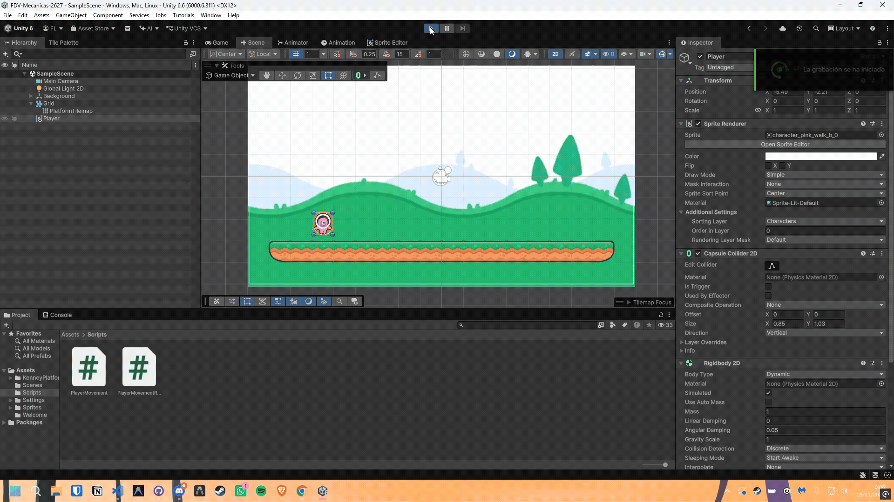
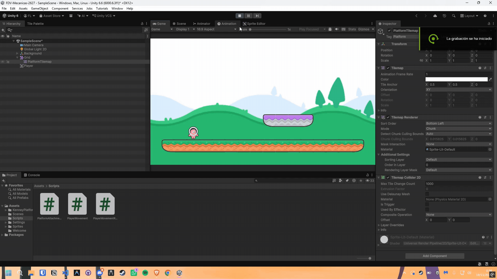
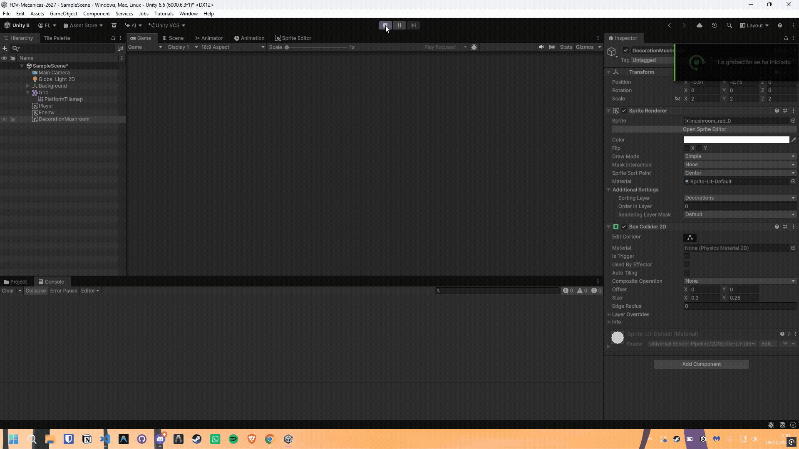
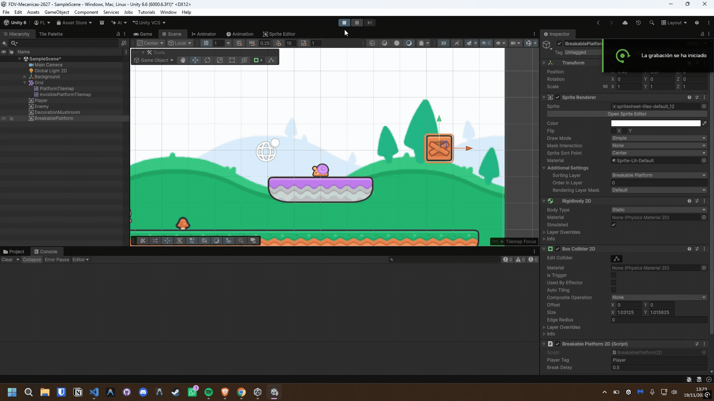
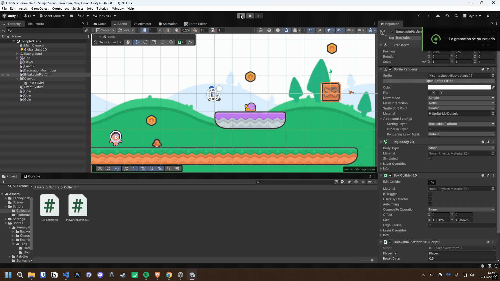
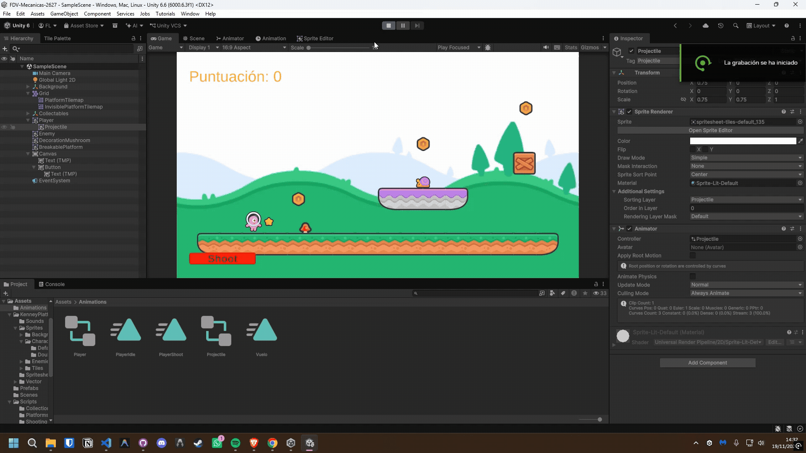
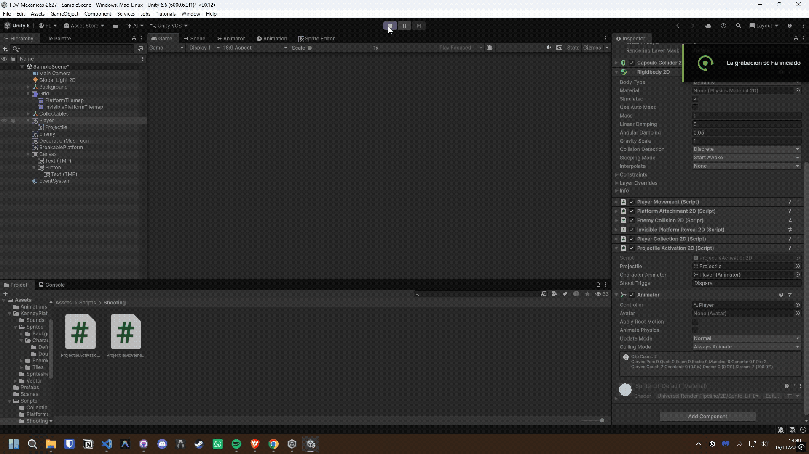

# FDV-Mecanicas-2627

## Salto

### Ejercicio 1

1. Recupera el Rigidbody2D del objeto y aplica una fuerza vertical al objeto cuando se pulse la tecla que hayas configurado para el salto en el Input. Manager:

```csharp
if ( Input.GetButtonDown("Jump")) {
// Aplica una fuerza vertical hacia arriba para realizar el salto.
        rb2D.AddForce(transform.up * thrust);
	
    }
```

**Resultado:**

```csharp
    void Update()
    {
        if (Input.GetButtonDown("Jump"))
        {
            jumpRequested = true;
        }
    }
    
    void FixedUpdate()
    {
        if (jumpRequested)
        {
            rb.linearVelocity = new Vector2(rb.linearVelocity.x, 0f);
            rb.AddForce(Vector2.up * thrust, ForceMode2D.Impulse);
            jumpRequested = false;
        }
    }
```

### Ejercicio 2

2. En este apartado se debe agregar el código que maneja que sólo se salte si el jugador está en el suelo. Para ello se deben agregar una etiqueta al suelo, de forma que nos permita identificarlo y mediante una variable que actuará de flag, activar o desactivar el salto.

```csharp
 if (Input.GetButton("Jump") && !isJumping)
{
    //Saltar
    ................
    //Desactivar la bandera.
    isJumping = true;
}
private void OnCollisionEnter2D(Collision2D other)
{
    //Si el jugador colisiona con un objeto con la etiqueta suelo
    {
        //Activar la bandera para que vuelva a saltar
        isJumping = false;
        //Anular la velocidad remanente que tuviera
        rb2d.velocity = new Vector2(rb2d.velocity.x, 0);
    }
}
```

**Resultado:**

```csharp
    void FixedUpdate()
    {
        if (isJumping && isGrounded) Jump();

        float moveHorizontal = Input.GetAxis("Horizontal");
        rb.linearVelocity = new Vector2(moveHorizontal * speed, rb.linearVelocity.y);
    }

    void Update()
    {
        if (Input.GetButtonDown("Jump") && !isJumping)
        {
            isJumping = true;
        }
    }

    private void Jump()
    {
        rb.linearVelocity = new Vector2(rb.linearVelocity.x, 0f);
        rb.AddForce(Vector2.up * thrust, ForceMode2D.Impulse);
        isGrounded = false;
    }

    private void OnCollisionEnter2D(Collision2D collision)
    {
        if (collision.gameObject.CompareTag("Platform"))
        {
            isGrounded = true;
            isJumping = false;
            rb.linearVelocity = new Vector2(rb.linearVelocity.x, 0f);
        }
    }
```

### Ejercicio 3

3. Opcional: Verificar si está en el suelo utilizando un Raycast. Para ello, lanzar el rayo desde los pies del jugador hasta el suelo, y si hay impacto con un objeto en la capa suelo en un rango muy corto, se considera que el jugador está en el suelo.

**Resultado:**

```csharp
    void FixedUpdate()
    {
        isGrounded = CheckGrounded();

        if (isJumping && isGrounded) Jump();

        float moveHorizontal = Input.GetAxis("Horizontal");
        rb.linearVelocity = new Vector2(moveHorizontal * speed, rb.linearVelocity.y);
    }

    private bool CheckGrounded()
    {
        Vector2 origin;

        if (groundCheck != null)
        {
            origin = groundCheck.position;
        }
        else if (playerCollider != null)
        {
            origin = new Vector2(
                playerCollider.bounds.center.x,
                playerCollider.bounds.min.y
            );
        }
        else
        {
            origin = transform.position;
        }

        RaycastHit2D hit = Physics2D.Raycast(
            origin,
            Vector2.down,
            groundCheckDistance,
            groundLayer
        );

        return hit.collider != null;
    }
```



## Plataformas

Salto a una plataforma: Esta mecánica se consigue con objetos físicos puesto que hay que implementar un salto, sin embargo, en este caso es necesario detectar la colisión con la plataforma y convertir el sistema de referencia del jugador en hijo de la plataforma. De esta forma conseguiremos que el jugador se mueva sobre/con ella. Del mismo modo una vez que el jugador no esté sobre la plataforma, debemos desvincularla de ella. Esto lo manejaremos cuando se produzca un evento. Desarrollar la versión para plataforma estática y plataforma en movimiento.

```csharp
void OnCollisionExit2D(Collision2D collision)
```

**Resultado:**

```csharp
public class PlatformAttachment2D : MonoBehaviour
{
    [SerializeField] private string[] platformTags = { "Platform" };
    [SerializeField] private bool requireTopContact = true;
    [SerializeField, Min(0f)] private float minimumUpwardNormal = 0.5f;

    private Transform currentPlatform;
    private Transform originalParent;

    private void OnCollisionEnter2D(Collision2D collision)
    {
        TryAttachToPlatform(collision);
    }

    private void OnCollisionStay2D(Collision2D collision)
    {
        if (currentPlatform == null) TryAttachToPlatform(collision);
    }

    private void OnCollisionExit2D(Collision2D collision)
    {
        if (collision.transform == currentPlatform) DetachFromPlatform();
    }

    private void OnDisable()
    {
        DetachFromPlatform();
    }

    private void TryAttachToPlatform(Collision2D collision)
    {
        if (!HasPlatformTag(collision.gameObject))               return;
        if (requireTopContact && !IsContactFromAbove(collision)) return;
        if (currentPlatform == null) originalParent = transform.parent;

        Transform platform = collision.transform;

        if (currentPlatform != platform)
        {
            transform.SetParent(platform, true);
            currentPlatform = platform;
        }
    }

    private bool HasPlatformTag(GameObject platform)
    {
        foreach (string tag in platformTags)
        {
            if (!string.IsNullOrEmpty(tag) && platform.CompareTag(tag))
            {
                return true;
            }
        }

        return false;
    }

    private bool IsContactFromAbove(Collision2D collision)
    {
        ContactPoint2D[] contacts = collision.contacts;
        foreach (ContactPoint2D contact in contacts)
        {
            if (Vector2.Dot(contact.normal, Vector2.up) >= minimumUpwardNormal)
            {
                return true;
            }
        }

        return false;
    }

    private void DetachFromPlatform()
    {
        if (currentPlatform == null) return;

        transform.SetParent(originalParent, true);
        currentPlatform = null;
        originalParent = null;
    }
}
```



## Colisiones con Capas

Manejar colisiones con elementos de una capa determinada: Podemos utilizar las capas para que el efecto de las colisiones sólo se tenga en cuenta cuando se pertenece a una determinada capa, o se descarten.

```csharp
void OnCollisionExit2D(Collision2D collision) {
    if (collision.gameObject.layer != LayerMask.NameToLayer("NoCollis")) {
        //Lógica para los elementos que si colisionan.
    }
}
```

**Resultado:**

```csharp
public class EnemyCollision2D : MonoBehaviour
{
    [SerializeField] private LayerMask enemyLayer;
    [SerializeField] private LayerMask ignoredLayer;

    private void OnCollisionEnter2D(Collision2D collision)
    {
        if (ShouldHandleCollision(collision))
        {
            Debug.Log("Colisión con un enemigo: " + collision.gameObject.name);
        }
    }

    private void OnCollisionExit2D(Collision2D collision)
    {
        if (ShouldHandleCollision(collision))
        {
            Debug.Log("Fin de la colisión con un enemigo: " + collision.gameObject.name);
        }
    }

    private bool ShouldHandleCollision(Collision2D collision)
    {
        if (ignoredLayer >= 0 && collision.gameObject.layer == ignoredLayer)
        {
            return false;
        }

        int collisionLayer = 1 << collision.gameObject.layer;
        return (enemyLayer.value & collisionLayer) != 0;
    }
}
```



## Plataformas Invisibles

Plataformas invisibles que se vuelven visibles mientras el jugador está sobre ellas: deben tener el tag `Invisible` y conservar activo su collider. El script se coloca en el jugador, oculta las plataformas al iniciar y muestra todos sus renderers mientras el jugador las toca desde arriba:

**Resultado:**

```csharp
public class InvisiblePlatformReveal2D : MonoBehaviour
{
    private readonly HashSet<GameObject> revealedPlatforms = new HashSet<GameObject>();

    private void Start()
    {
        GameObject[] invisiblePlatforms = GameObject.FindGameObjectsWithTag("Invisible");
        foreach (GameObject platform in invisiblePlatforms)
        {
            SetPlatformVisibility(platform, false);
        }
    }

    private void OnCollisionEnter2D(Collision2D collision)
    {
        TryRevealPlatform(collision);
    }

    private void OnCollisionStay2D(Collision2D collision)
    {
        TryRevealPlatform(collision);
    }

    private void OnCollisionExit2D(Collision2D collision)
    {
        GameObject platform = FindInvisiblePlatform(collision.gameObject);
        if (platform == null || !revealedPlatforms.Remove(platform)) return;

        SetPlatformVisibility(platform, false);
    }

    private void TryRevealPlatform(Collision2D collision)
    {
        if (!Contact2D.IsContactFromAbove(collision)) return;

        GameObject platform = FindInvisiblePlatform(collision.gameObject);
        if (platform == null || !revealedPlatforms.Add(platform)) return;

        SetPlatformVisibility(platform, true);
    }

    private GameObject FindInvisiblePlatform(GameObject collisionObject)
    {
        Transform current = collisionObject.transform;
        while (current != null)
        {
            if (current.CompareTag("Invisible")) return current.gameObject;
            current = current.parent;
        }

        return null;
    }

    private void SetPlatformVisibility(GameObject platform, bool isVisible)
    {
        Renderer[] renderers = platform.GetComponentsInChildren<Renderer>(true);
        foreach (Renderer renderer in renderers) renderer.enabled = isVisible;
    }
}
```


## Plataforma que se Rompe

Plataforma que se cae o rompe: El jugador físico, la plataforma cinemática, cuando el jugador salta a la plataforma establecer rigidbody dinámico a la plataforma, con esto conseguiremos que caiga. Activaremos una corrutina de espera: yield return new WaitForSeconds(0.5f); 

**Resultado:**

```csharp
public class BreakablePlatform2D : MonoBehaviour
{
    [SerializeField] private string playerTag = "Player";
    [SerializeField, Min(0f)] private float breakDelay = 0.5f;

    private Rigidbody2D platformRigidbody;
    private bool isBreaking;

    private void Awake()
    {
        platformRigidbody = GetComponent<Rigidbody2D>();
        if (platformRigidbody == null)
        {
            Debug.LogError("BreakablePlatform2D necesita un Rigidbody2D.", this);
        }
    }

    private void OnCollisionEnter2D(Collision2D collision)
    {
        if (isBreaking || platformRigidbody == null) return;
        if (!collision.gameObject.CompareTag(playerTag)) return;
        if (!Contact2D.IsContactFromAbove(collision, Vector2.down)) return;

        isBreaking = true;
        StartCoroutine(BreakPlatform());
    }

    private IEnumerator BreakPlatform()
    {
        yield return new WaitForSeconds(breakDelay);
        platformRigidbody.bodyType = RigidbodyType2D.Dynamic;
    }
}
```



## Mecánica de Recolección

Mecánica de recolección: La recolección de objetos se realiza implementando la lógica de la recolección en alguno de los eventos de colisión con ese objeto. En ocasiones se actualizará la UI, en otras se destruirá el objeto, en otras se mejora alguna característica del personaje. En esta tarea se debe implementar una mecánica en la que el jugador recolecte objetos que le supongan alguna recompensa. En concreto, aumentará su puntuación, al llega a un valor de incremento de puntuación, adquirirá más potencia de salto. La puntuación se mostrará continuamente en la pantalla. El objeto recolectado ya no se usará más.

El jugador debe tener `PlayerCollection2D` y una referencia a un elemento `TextMeshProUGUI` para mostrar la puntuación. Cada objeto recolectable debe tener `Collectible2D`, un collider 2D y el tag configurado para el jugador. Por defecto, cada objeto suma 1 punto y cada 2 puntos aumenta la potencia del salto en 2.5.

```csharp
public class Collectible2D : MonoBehaviour
{
    [SerializeField] private string playerTag = "Player";
    [SerializeField, Min(1)] private int scoreValue = 1;

    private void OnTriggerEnter2D(Collider2D other)
    {
        if (!other.CompareTag(playerTag)) return;

        PlayerCollection2D collection = other.GetComponent<PlayerCollection2D>();
        if (collection == null) return;

        collection.AddScore(scoreValue);
        Destroy(gameObject);
    }
}
```

```csharp
public class PlayerCollection2D : MonoBehaviour
{
    [SerializeField] private TMP_Text scoreText;
    [SerializeField, Min(1)] private int pointsForJumpUpgrade = 2;
    [SerializeField, Min(0f)] private float jumpPowerIncrease = 2.5f;

    private PlayerMovement playerMovement;
    private PlayerMovementRaycast playerMovementRaycast;
    private int score;
    private int nextUpgradeScore;

    public int Score => score;

    private void Awake()
    {
        playerMovement = GetComponent<PlayerMovement>();
        playerMovementRaycast = GetComponent<PlayerMovementRaycast>();
        nextUpgradeScore = pointsForJumpUpgrade;
        UpdateScoreText();
    }

    public void AddScore(int points)
    {
        if (points <= 0) return;

        score += points;
        while (score >= nextUpgradeScore)
        {
            IncreaseJumpPower();
            nextUpgradeScore += pointsForJumpUpgrade;
        }

        UpdateScoreText();
    }

    private void IncreaseJumpPower()
    {
        if (playerMovement != null)
        {
            playerMovement.IncreaseJumpPower(jumpPowerIncrease);
        }

        if (playerMovementRaycast != null)
        {
            playerMovementRaycast.IncreaseJumpPower(jumpPowerIncrease);
        }
    }

    private void UpdateScoreText()
    {
        if (scoreText != null)
        {
            scoreText.text = $"Puntuación: {score}";
        }
    }
}
```

```csharp
public class PlayerMovement : MonoBehaviour
{
    public void IncreaseJumpPower(float amount)
    {
        thrust += amount;
    }
}
```



## Disparo

Mecánica de disparo: Desarrollo de la acción de disparo de forma incremental como se indica a continuación:

- Sprite y visibilidad. Crea un GameObject con un sprite para el proyectil. Al iniciar el juego debe estar desactivado (SetActive(false)). Añade un botón de UI que lo active con SetActive(true). Crea una animación Vuelo para el proyectil que se reproduzca al activarse (estado por defecto del Animator). El personaje tendrá sus propias animaciones, con al menos la transición Idle → Dispara mediante un Trigger.

Para este primer paso, se añadió `ProjectileActivation2D` al jugador y se asignó el proyectil que será su hijo. El método público `ActivateProjectile()` se conectó al evento `OnClick` del botón UI. El script desactiva el proyectil al iniciar, lo activa al pulsar el botón y lanza el trigger `Dispara` del Animator del personaje si está asignado.

```csharp
public class ProjectileActivation2D : MonoBehaviour
{
    [SerializeField] private GameObject projectile;
    [SerializeField] private Animator characterAnimator;
    [SerializeField] private string shootTrigger = "Dispara";
    
    private void Start()
    {
        if (projectile == null)
        {
            Debug.LogError("ProjectileActivation2D necesita un proyectil asignado.", this);
            return;
        }
        
        projectile.SetActive(false);
    }

    public void ActivateProjectile()
    {
        if (projectile == null) return;

        projectile.SetActive(true);
        
        if (characterAnimator != null)
        {
            characterAnimator.SetTrigger(shootTrigger);
        }
    }
}
```



- Jerarquía. Coloca el proyectil como hijo del jugador y comprueba que se mueve con él. Haz que el proyectil avance al activarse. Compara: (a) desactivar el SpriteRenderer (SpriteRenderer.enabled = false) del jugador y (b) desactivar el GameObject del jugador con SetActive(false). ¿Qué ocurre con el proyectil en cada caso? ¿Qué pasa si el jugador se mueve mientras el proyectil vuela?.

Para este paso, se añadió `ProjectileMovement2D` al proyectil. El método `StartMoving()` se conectó al evento `OnAnimationEvent` de la animación Vuelo del proyectil. El script mueve el proyectil hacia la derecha a una velocidad configurable mientras está activo.

```csharp
public class ProjectileMovement2D : MonoBehaviour
{
    [SerializeField, Min(0f)] private float speed = 5f;

    private bool isMoving;
    private Vector2 movementDirection;

    private void OnEnable()
    {
        isMoving = false;
        movementDirection = Vector2.zero;
    }

    private void Update()
    {
        if (!isMoving) return;

        transform.Translate(movementDirection * speed * Time.deltaTime, Space.World);
    }

    public void StartMoving()
    {
        movementDirection = transform.right.normalized;
        isMoving = true;
    }
}
```



- Ocultamiento automático. Haz que el proyectil se desactive solo, al cabo de un tiempo (usando una corrutina) o al terminar la animación (usando un Animation Event). Sincroniza el disparo del proyectil con el Trigger Dispara del personaje.

- Prefab e instanciación. Convierte el proyectil en prefab y elimínalo de la escena. Desde el jugador, instáncialo en un punto de disparo al pulsar el botón, sin hacerlo hijo del jugador. Destrúyelo automáticamente con Destroy(gameObject, tiempo) o al chocar.

- Disparo por eventos. Sustituye el botón por al pulsar una tecla o botón Disparo. Además, cuando el jugador colisione con un objeto determinado, debe lanzar un evento. Un componente Lanzador del jugador estará suscrito a ese evento y, al recibirlo, instanciará el proyectil.
